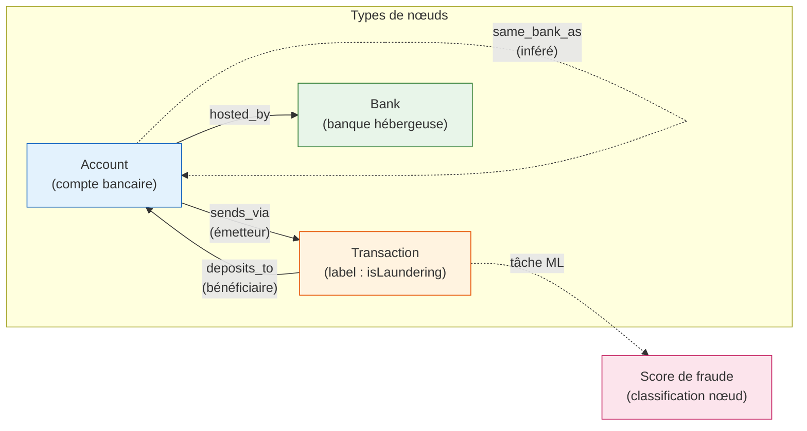
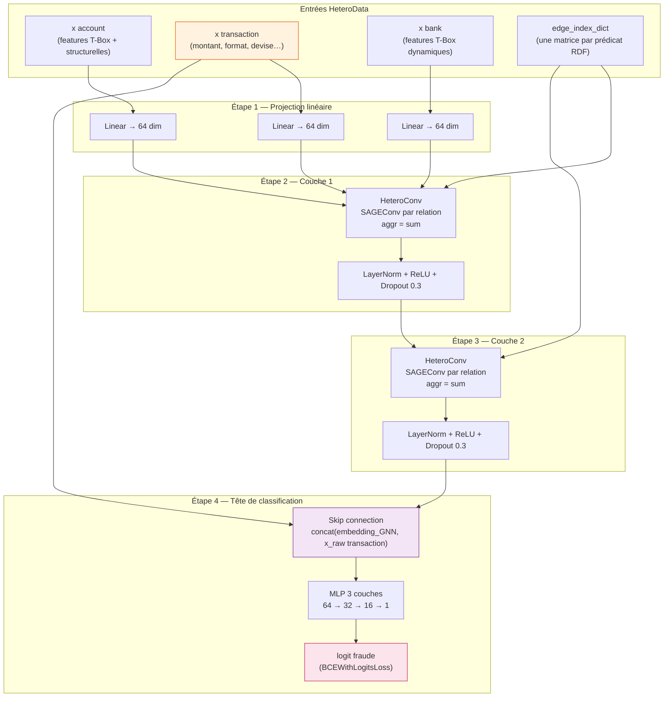
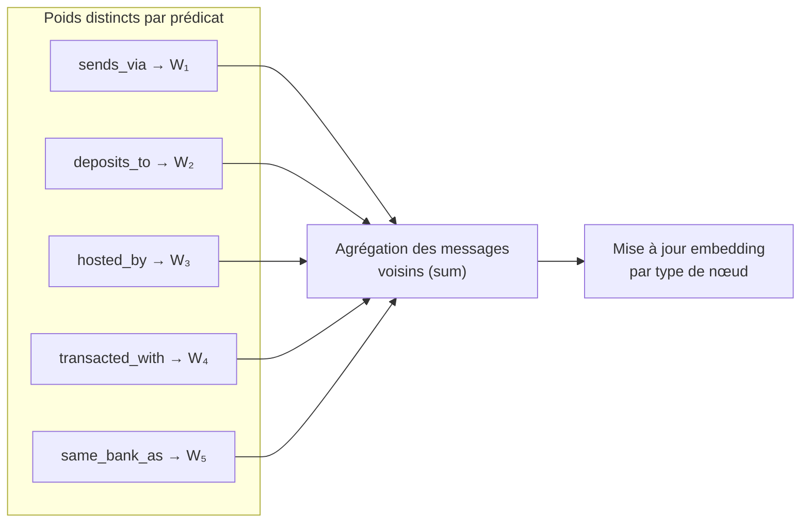
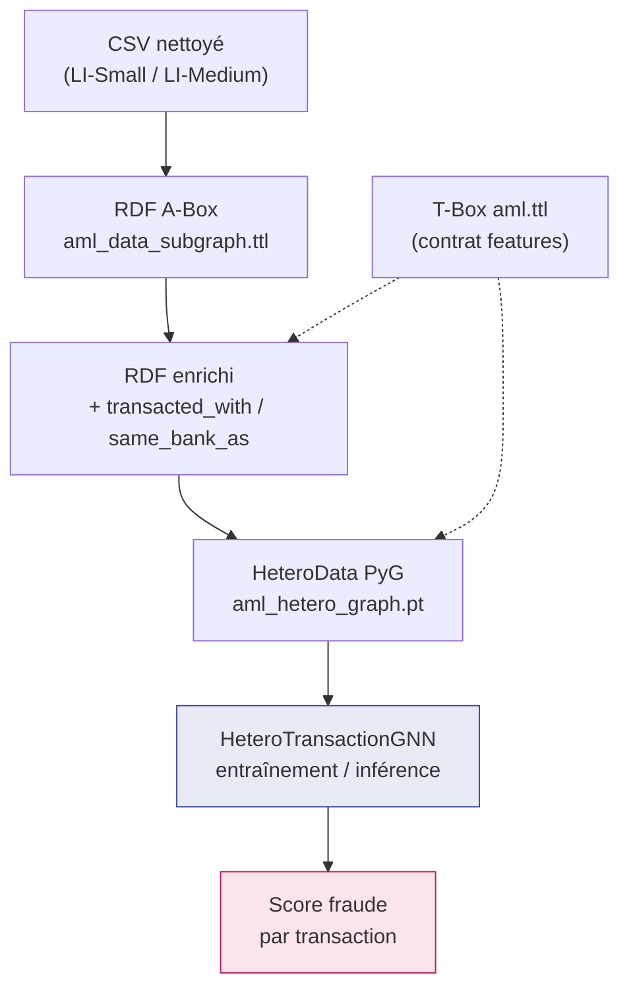
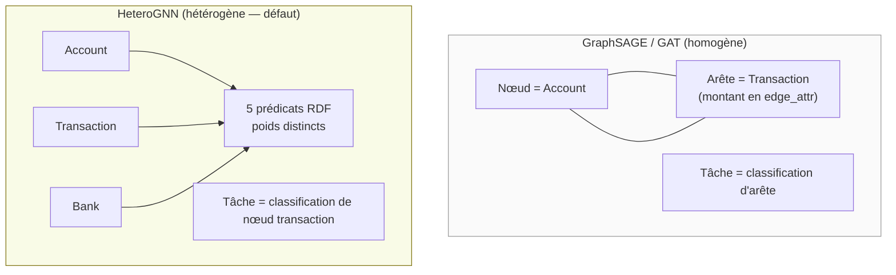

# Architecture HeteroGNN — schémas visuels

**Projet** — Connect AI / AML — Samir KHALDI  
**Module** — `src/gnn/hetero/models.py` (`HeteroTransactionGNN`)  
**Graphe** — `HeteroData` PyG depuis RDF enrichi (`src/rdf/to_hetero_pyg.py`)

Ce document regroupe les diagrammes Mermaid pour illustrer l'architecture HeteroGNN
(graphe hétérogène + réseau de neurones). Les schémas sont versionnables et
exportables en PNG pour slides ou rapport.

**Documents liés** : [`guide_detaille.md`](../guides/guide_detaille.md) (§8),
[`comparaison_modeles_gnn.md`](../analysis/comparaison_modeles_gnn.md),
[`pipeline_etl_entrainement_evaluation.md`](../pipeline_etl_entrainement_evaluation.md).

---

## 1. Graphe hétérogène (RDF → PyG)

Chaque prédicat RDF devient un type d'arête distinct dans PyG. Les relations
`transacted_with` et `same_bank_as` sont **inférées** par `src/rdf/inference.py`
à partir des transactions observées.



| Élément | Détail |
|---------|--------|
| **Nœuds** | `account`, `transaction`, `bank` |
| **Relations observées** | `sends_via`, `deposits_to`, `hosted_by` |
| **Relations inférées** | `transacted_with`, `same_bank_as` (+ arêtes inverses dans PyG) |
| **Label** | `isLaundering` sur chaque nœud `transaction` (0/1) |
| **Fichier PyG** | `data/train_data/pyg/aml_hetero_graph.pt` |

**Message clé pour la soutenance** : contrairement au graphe homogène (compte→compte),
la sémantique de chaque prédicat RDF est **préservée** — le modèle peut apprendre
des transformations distinctes par type de relation.

---

## 2. Forward pass du modèle `HeteroTransactionGNN`

Architecture implémentée dans `HeteroTransactionGNN` : projection linéaire par type
de nœud, puis 2 couches `HeteroConv` (chaque prédicat → `SAGEConv` dédié),
concaténation skip avec les features brutes transaction, et MLP de classification.



### Détail d'une couche HeteroConv

Pour chaque type d'arête `(src, relation, dst)`, le message passing utilise un
`SAGEConv` **indépendant** — équivalent pratique du R-GCN sur graphe RDF :



| Bloc | Rôle |
|------|------|
| `lin_dict` | Projette chaque type de nœud vers un espace commun (64 dim) |
| `HeteroConv × 2` | Message passing multi-relationnel ; un SAGEConv par prédicat |
| `LayerNorm` | Stabilise l'entraînement après chaque couche |
| Skip connection | Préserve les features T-Box brutes de la transaction (extensibilité) |
| `head` (MLP) | Produit un logit binaire par transaction |

---

## 3. Position dans le pipeline global



Pipeline détaillé (train + hold-out) : [`pipeline_etl_entrainement_evaluation.md`](../pipeline_etl_entrainement_evaluation.md).

---

## 4. Hyperparamètres

| Paramètre | Valeur | Fichier / config |
|-----------|--------|------------------|
| `hidden_channels` | 64 | `src/config.py` |
| `num_layers` | 2 | `src/config.py` |
| `dropout` | 0,3 | `src/config.py` |
| `head_hidden` | 64 | `src/config.py` |
| `lr` | 0,001 | `src/config.py` |
| `pos_weight` | ~55 | `src/gnn/hetero/training.py` (déséquilibre classes) |
| Loss | `BCEWithLogitsLoss` | Early stopping sur Val PR-AUC |

---

## 5. Comparaison rapide Homo vs Hetero



---

## 6. Exporter en PNG (slides / rapport)

### Option A — Mermaid Live Editor

1. Copier un bloc ` ```mermaid ` ci-dessus.
2. Coller sur [mermaid.live](https://mermaid.live).
3. Exporter en PNG ou SVG.

### Option B — CLI Mermaid

```powershell
npm install -g @mermaid-js/mermaid-cli

# Exemple : extraire le diagramme §2 dans un fichier .mmd puis :
mmdc -i hetero_forward.mmd -o hetero_forward.png -b transparent
```

### Option C — draw.io / PowerPoint

Reproduire manuellement les schémas ci-dessus en appliquant la palette suggérée :

| Type | Couleur suggérée |
|------|------------------|
| Account | Bleu clair |
| Transaction | Orange clair |
| Bank | Vert clair |
| Relations inférées | Traits pointillés |
| Score / label | Rose |

---

## 7. Références code

| Fichier | Contenu |
|---------|---------|
| `src/gnn/hetero/models.py` | `HeteroTransactionGNN` |
| `src/gnn/hetero/training.py` | Boucle d'entraînement, checkpoint |
| `src/rdf/to_hetero_pyg.py` | Construction `HeteroData` |
| `src/rdf/inference.py` | Inférence `transacted_with`, `same_bank_as` |
| `src/app/hetero_inference.py` | Inférence unitaire (app Streamlit) |
