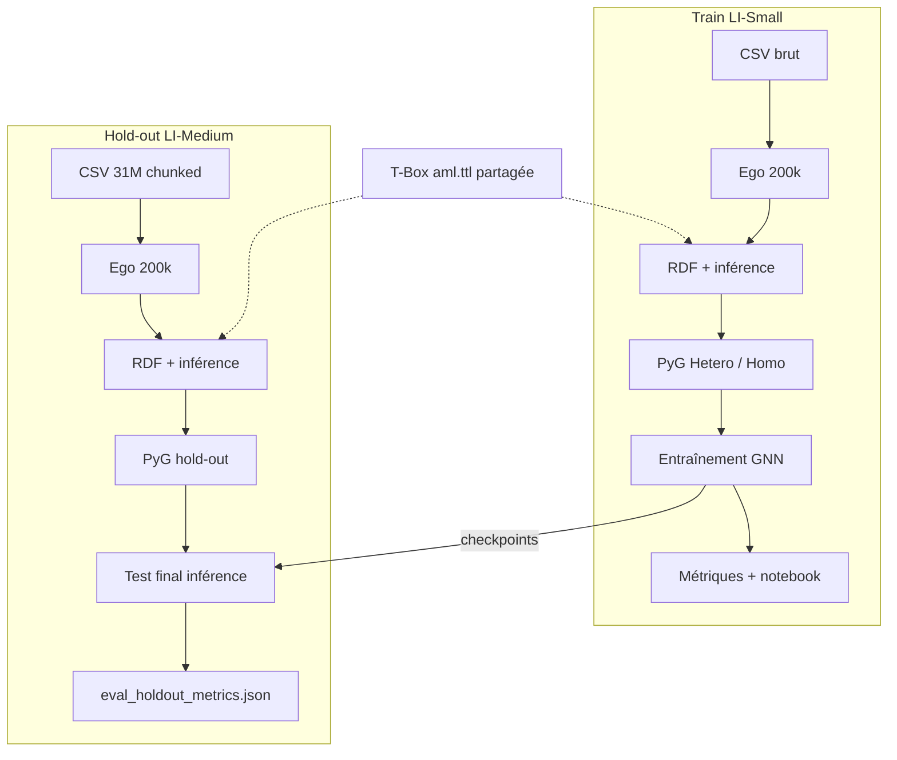

# Pipeline complet — De la donnée brute au test final

**Projet** — Connect AI / Détection AML par GNN (anomalie structurelle)  
**Auteur** — Samir KHALDI  
**Dernière mise à jour** — 02/06/2026 (test final hold-out complété)

> Document de référence : **toutes les étapes** du pipeline (ETL → RDF → PyG → entraînement → évaluation), la définition des jeux **train** et **hold-out**, et les **résultats du test final** (soutenance).

---

## En quelques phrases : qu’avons-nous fait ?

Nous avons construit un **pipeline reproductible** qui part de transactions bancaires IBM (CSV), les transforme en **graphe sémantique RDF** conforme à une ontologie (T-Box), puis en **tenseur PyTorch Geometric** pour entraîner des **GNN** de détection de fraude. L’entraînement a été mené sur un sous-graphe de **200 000 transactions** extrait de **LI-Small** (`data/train_data/`). Un second jeu **LI-Medium** (`data/unknown_data/`) — **jamais vu à l’entraînement** — a été traité avec la **même méthode** (ego 200k, T-Box partagée) ; les checkpoints train ont été évalués en **inférence seule** (test de généralisation, **02/06/2026**).

---

## Glossaire rapide (votre question)

### Qu’est-ce que « ego » (avant plafond) ?

**Ego** = *ego-network* (réseau ego) : on part de chaque **fraude** et on récupère les **comptes** impliqués, puis leurs **voisins** (ici à **1 saut** / 1 hop), puis **toutes les transactions** qui relient ces comptes.

| Terme | Signification |
|-------|----------------|
| **Ego avant plafond** | Toutes les transactions collectées par cette expansion **avant** de couper à 200 000 lignes |
| **Plafond** (`EGO_TARGET_SIZE = 200 000`) | Limite fixe pour aligner train et hold-out et rester entraînable sur laptop |

**Exemple LI-Medium (hold-out)** :

- **Avant plafond** : **12 126 651** transactions (dont **16 041** fraudes — **100 %** gardées)
- **Après plafond** : **200 000** transactions (toujours **16 041** fraudes, + un tirage de transactions légitimes)

Sur LI-Small (train), l’ego avant plafond était **2 451 392** transactions → plafonné à **200 000** avec **3 565** fraudes.

### Qu’est-ce que le « degré moyen 1,85 » ?

Dans notre modèle de graphe pour le GNN homogène, un **nœud = compte bancaire**, une **arête = transaction** (émetteur → destinataire).

Le **degré** d’un compte = nombre de transactions dans lesquelles il apparaît (comme émetteur ou destinataire).

| Métrique | LI-Medium (hold-out) | Lecture |
|----------|----------------------|---------|
| **Degré moyen 1,85** | En moyenne, chaque compte n’apparaît que dans ~2 transactions | Graphe **peu dense** → message passing limité |
| **Degré médian 1,00** | La moitié des comptes n’ont qu’**une** transaction | Beaucoup de comptes « isolés » |
| **62,72 % de degré = 1** | 62 % des comptes n’ont qu’un seul lien | Moins favorable qu’en train (LI-Small : degré moy. **3,30**, ~36 % de degré 1) |

Un degré moyen **bas** ne signifie pas que le fichier est incorrect : sur un réseau financier massif (31 M de lignes), l’expansion 1-hop autour des fraudes produit souvent beaucoup de comptes peu actifs. C’est une information **importante pour interpréter** les scores du test final.

---

## Architecture des données

```
Project/
├── data/train_data/          # Entraînement + checkpoints (LI-Small)
│   ├── csv/raw|cleaned/
│   ├── rdf/ontology_data/  # A-Box générées
│   ├── pyg/                  # aml_hetero_graph.pt, aml_graph.pt
│   └── results/              # gnn_{hetero,sage,gat}_best.pt
│
├── data/unknown_data/        # Hold-out — inconnu au modèle entraîné (LI-Medium)
│   ├── csv/raw|cleaned/
│   ├── rdf/ontology_data/    # (après pipeline 08)
│   ├── pyg/
│   └── results/              # eval_holdout_metrics.json (après test final)
│
└── data/train_data/rdf/ontology_schema/aml.ttl   # T-Box UNIQUE (partagée)
```

| Jeu | Fichier source | Rôle | Connu du modèle ? |
|-----|----------------|------|-------------------|
| **Train** | `LI-Small_Trans.csv` | Apprendre les poids GNN | Oui (entraînement + val + test internes) |
| **Hold-out** | `LI-Medium_Trans.csv` (~31 M lignes) | Test de **généralisation** | **Non** — jamais utilisé à l’entraînement |

---

## Pipeline ETL → modèle → évaluation (train)

### Phase A — Extraction et échantillonnage (CSV)

| # | Étape | Script | Entrée → Sortie | Statut |
|---|--------|--------|-----------------|--------|
| A1 | Échantillon stratifié (démo RDF 100k) | `01_sample_data.py` | Brut → `LI-Small_Trans_sample.csv` | ✅ |
| A2 | **Sous-graphe ego 200k** (GNN) | `03_subgraph_sample.py` `--data-profile train` | Brut → `LI-Small_Trans_subgraph.csv` | ✅ |

**Résultat train (sous-graphe)** : 200 000 tx, 3 565 fraudes (1,78 %), 121 082 comptes, degré moy. 3,30.

### Phase B — Web sémantique (RDF)

| # | Étape | Script | Sortie | Statut |
|---|--------|--------|--------|--------|
| B1 | A-Box sous-graphe | `02b_build_rdf_subgraph.py` | `aml_data_subgraph.ttl` | ✅ |
| B2 | Inférence (`transactedWith`, `sameBankAs`) | `02c_enrich_rdf.py` | `aml_data_subgraph_enriched.ttl` | ✅ |

**T-Box** : `data/train_data/rdf/ontology_schema/aml.ttl` (schéma partagé train + hold-out).

### Phase C — Feature engineering → tenseur PyG

| # | Étape | Script | Sortie | Statut |
|---|--------|--------|--------|--------|
| C1 | Graphe hétérogène (défaut) | `04_build_pyg.py --mode hetero` | `aml_hetero_graph.pt` | ✅ |
| C2 | Graphe homogène (legacy SAGE/GAT) | `04_build_pyg.py --mode homo` | `aml_graph.pt` | ✅ |

Splits internes : **70 % train / 15 % val / 15 % test** (stratifié, seed 42).

### Phase D — Entraînement des modèles

| Modèle | Script | Checkpoint | Métriques | Statut |
|--------|--------|--------------|-----------|--------|
| **HeteroGNN** (défaut) | `05_train_gnn.py --model hetero` | `gnn_hetero_best.pt` | `gnn_hetero_metrics.json` | ✅ |
| **GraphSAGE** | `05_train_gnn.py --model sage` | `gnn_sage_best.pt` | `gnn_sage_metrics.json` | ✅ |
| **GAT** | `05_train_gnn.py --model gat` | `gnn_gat_best.pt` | `gnn_gat_metrics.json` | ✅ |

Early stopping sur **PR-AUC** (validation). Loss : `BCEWithLogitsLoss` avec `pos_weight` (classes déséquilibrées).

### Phase E — Évaluation et analyse (sur le jeu train)

| # | Étape | Outil | Statut |
|---|--------|-------|--------|
| E1 | Courbes, matrices, comparaison modèles | `notebooks/metrics_evaluation.ipynb` | ✅ |
| E2 | Convergence SAGE vs Hetero (epoch par epoch) | `06_compare_convergence.py` | ✅ |
| E3 | Rapport / comparaison conceptuelle | `docs/reports/final_report.md`, `docs/analysis/comparaison_modeles_gnn.md` | ✅ |

### Phase E-hold — Visualisations test final (LI-Medium)

Mêmes types de livrables que la phase E, dans `data/unknown_data/results/` :

| # | Étape | Outil | Statut |
|---|--------|-------|--------|
| E1-h | Métriques + graphiques hold-out | `scripts/09_visualize_holdout.py` (ou `07_eval_holdout.py --viz`) | ✅ **02/06/2026** |
| E1-h nb | Affichage interactif (soutenance) | `notebooks/holdout_metrics_evaluation.ipynb` | ✅ |
| E2-h | Comparaison train vs hold-out + réf. convergence | figures `holdout_train_vs_holdout_*.png`, `holdout_train_convergence_reference.png` | ✅ |

**Fichiers produits** (principaux) :

| Fichier | Description |
|---------|-------------|
| `eval_holdout_metrics.json` | Rapport numérique (3 modèles) |
| `gnn_{hetero,sage,gat}_holdout_metrics.json` | Format compatible notebook |
| `holdout_metrics_summary.csv` | Tableau récapitulatif |
| `holdout_metrics_grid.png` | Grille PR-AUC / Recall / Precision / F1 |
| `holdout_pr_auc_bars.png` | Barres PR-AUC + ligne hasard |
| `holdout_architecture_comparison.png` | Comparaison architectures |
| `holdout_architecture_radar.png` | Radar des 4 métriques |
| `holdout_pr_curves_all_models.png` | Courbes PR (3 modèles) |
| `holdout_confusion_matrices_all_models.png` | Matrices de confusion |
| `holdout_score_distributions_all_models.png` | Distributions des scores |
| `holdout_pr_curve_hetero.png` | PR détaillée HeteroGNN |
| `holdout_confusion_matrix_hetero.png` | Confusion HeteroGNN |
| `holdout_score_distribution_hetero.png` | Scores HeteroGNN |
| `holdout_train_vs_holdout_pr_auc.png` (etc.) | Généralisation Small → Medium |
| `holdout_train_convergence_reference.png` | Convergence à l’entraînement (réf.) |
| `holdout_viz_manifest.json` | Index de tous les artefacts |

```powershell
python scripts/07_eval_holdout.py
# ou uniquement les figures si eval_holdout_metrics.json existe déjà :
python scripts/09_visualize_holdout.py
jupyter notebook notebooks/holdout_metrics_evaluation.ipynb
```

---

## Pipeline hold-out — nouveau dataset (LI-Medium)

**Principe** : même ETL et mêmes hyperparamètres d’échantillonnage, **aucun ré-entraînement** sur Medium. Les checkpoints de `train_data/results/` sont appliqués tels quels.

### Définition du dataset « inconnu »

| Propriété | Valeur |
|-----------|--------|
| Nom IBM | LI-Medium |
| Fichier brut | `data/unknown_data/csv/raw/LI-Medium_Trans.csv` |
| Volume brut | **31 251 483** transactions |
| Fraudes dans le brut | **16 041** (0,051 %) |
| Méthode d’échantillonnage | Ego K=1, seed 42, plafond **200 000**, 100 % fraudes conservées au tronquage |
| Mode technique | Lecture **chunked** (50 000 lignes/morceau) — pas de chargement intégral en RAM |
| Sous-graphe produit | `data/unknown_data/csv/cleaned/LI-Medium_Trans_subgraph.csv` |

**Résultat hold-out (02/06/2026)** :

| Indicateur | Valeur |
|------------|--------|
| Transactions | 200 000 |
| Fraudes | 16 041 (**8,02 %**) |
| Ego avant plafond | 12 126 651 tx |
| Comptes | 216 008 |
| Degré moyen | **1,85** |

### Étapes hold-out — statut

| # | Étape | Commande | Statut |
|---|--------|----------|--------|
| H1 | Sous-graphe ego 200k | `python scripts/03_subgraph_sample.py --data-profile unknown` | ✅ **02/06/2026** |
| H2 | A-Box sous-graphe | `02b_build_rdf_subgraph.py --data-profile unknown` | ✅ **02/06/2026** |
| H3 | Inférence RDF | `02c_enrich_rdf.py --data-profile unknown` | ✅ **02/06/2026** |
| H4 | PyG hetero + homo (`--holdout-eval`) | `04_build_pyg.py --data-profile unknown` | ✅ **02/06/2026** |
| H5 | **Test final** (inférence seule) | `07_eval_holdout.py` | ✅ **02/06/2026** |

```powershell
# Enchaînement complet (sous-graphe déjà fait)
python scripts/08_run_unknown_holdout_pipeline.py --skip-subgraph

# Ou uniquement rebuild hetero + évaluation
python scripts/04_build_pyg.py --data-profile unknown --mode hetero --holdout-eval
python scripts/07_eval_holdout.py
```

**Livrable** : `data/unknown_data/results/eval_holdout_metrics.json`

### Résultats du test final (LI-Medium, 200 000 tx, 16 041 fraudes)

Évaluation sur **100 %** des transactions du sous-graphe hold-out (masque test = graphe entier). Checkpoints : `data/train_data/results/gnn_{hetero,sage,gat}_best.pt`.

| Modèle | PR-AUC | Recall | Precision | F1 | Loss BCE |
|--------|--------|--------|-----------|-----|----------|
| **HeteroGNN** | **0,595** | 0,699 | **0,544** | **0,612** | 0,304 |
| GraphSAGE | 0,229 | **0,781** | 0,133 | 0,228 | 0,631 |
| GAT | 0,150 | 0,643 | 0,114 | 0,194 | 0,687 |

### Comparaison train (test interne LI-Small) vs hold-out (LI-Medium)

| Modèle | PR-AUC train (test 15 %) | PR-AUC hold-out | Δ PR-AUC | Lecture |
|--------|--------------------------|-----------------|----------|---------|
| HeteroGNN | 0,254 | **0,595** | +0,34 | Meilleur **classement** (PR-AUC) hors échantillon ; recall plus bas qu’en train (70 % vs 95 %) mais precision bien meilleure (54 % vs 6 %) |
| GraphSAGE | 0,254 | 0,229 | −0,02 | Recall élevé (78 %) mais **nombreux faux positifs** (precision 13 %) |
| GAT | 0,047 | 0,150 | +0,10 | Toujours le plus faible des trois ; légère remontée vs test train |

> Les métriques **train** proviennent du split interne 70/15/15 sur LI-Small (voir `docs/analysis/comparaison_modeles_gnn.md` §3). Le hold-out n’est **pas** un ré-entraînement : même T-Box, alignement des dimensions de features sur le checkpoint (`align_feature_bundle`, flag `--holdout-eval`).

### Points clés pour la soutenance

1. **Protocole** : Option A validée — corpus IBM **Medium** inconnu au modèle, même taille d’échantillon (200k) et même pipeline ETL que Small.
2. **HeteroGNN** : seul modèle **équilibré** (PR-AUC et F1 élevés, precision exploitable pour du triage d’alertes).
3. **SAGE / GAT homogènes** : recall élevé mais **PR-AUC faible** → mauvais ordonnancement des suspects, seuil trop agressif (alertes majoritairement non frauduleuses).
4. **Contexte graphe** : hold-out plus **fragmenté** (degré moy. 1,85 vs 3,30) et plus **riche en fraudes** (8,02 % vs 1,78 %) — les écarts de métriques ne signifient pas une « dégradation » absolue du modèle.
5. **Incident résolu** : dimensions `bank` incompatibles (9 vs 2) corrigées par alignement des colonnes de features sur `hetero_info` du checkpoint train avant inférence.

### Alignement des features (hold-out)

Sur LI-Medium, l’extraction dynamique depuis la T-Box produisait plus de catégories `bankCode` (one-hot 9D) qu’à l’entraînement (2D). Le build PyG hold-out appelle `hetero_feature_names_from_train()` et `align_feature_bundle()` pour reproduire le schéma du checkpoint (`bank` 2D, `transaction` 27D, `account` 5D).

---

## Schéma global (train + hold-out)



---

## Commandes de reproduction (mémo)

### Train (complet)

```powershell
pip install -r requirements.txt
python scripts/03_subgraph_sample.py --data-profile train
python scripts/02b_build_rdf_subgraph.py --data-profile train
python scripts/02c_enrich_rdf.py --data-profile train
python scripts/04_build_pyg.py --data-profile train --mode hetero
python scripts/05_train_gnn.py --data-profile train --model hetero
python scripts/05_train_gnn.py --data-profile train --model sage
python scripts/05_train_gnn.py --data-profile train --model gat
```

### Hold-out (après sous-graphe)

```powershell
python scripts/08_run_unknown_holdout_pipeline.py --skip-subgraph
jupyter notebook notebooks/metrics_evaluation.ipynb
```

---

## Documents liés

| Document | Contenu |
|----------|---------|
| [`reports/process_log.md`](reports/process_log.md) | Journal détaillé QUOI / POURQUOI / COMMENT |
| [`guides/concepts_explained.md`](guides/concepts_explained.md) | Ego-sampling, RDF, GNN, métriques |
| [`guides/guide_detaille.md`](guides/guide_detaille.md) | Guide pas à pas soutenance |
| [`analysis/comparaison_modeles_gnn.md`](analysis/comparaison_modeles_gnn.md) | Comparaison SAGE / GAT / Hetero |
| [`data/train_data/README.md`](../data/train_data/README.md) | Fichiers train |
| [`data/unknown_data/README.md`](../data/unknown_data/README.md) | Fichiers hold-out + chiffres ego |
| [`notebooks/holdout_metrics_evaluation.ipynb`](../notebooks/holdout_metrics_evaluation.ipynb) | Visualisations interactives hold-out |

---

## Fiche mémo soutenance (30 secondes)

> *« Nous entraînons sur LI-Small (200k tx, 1,78 % de fraudes), puis nous testons sans ré-apprendre sur LI-Medium (200k tx, 8 % de fraudes, 31 M lignes en amont). Le HeteroGNN atteint PR-AUC 0,59 et F1 0,61 sur ce hold-out ; les GNN homogènes sur-alertent (recall élevé, precision ~12 %). Cela montre que la représentation RDF multi-relationnelle généralise mieux qu’un graphe aplati. »*
